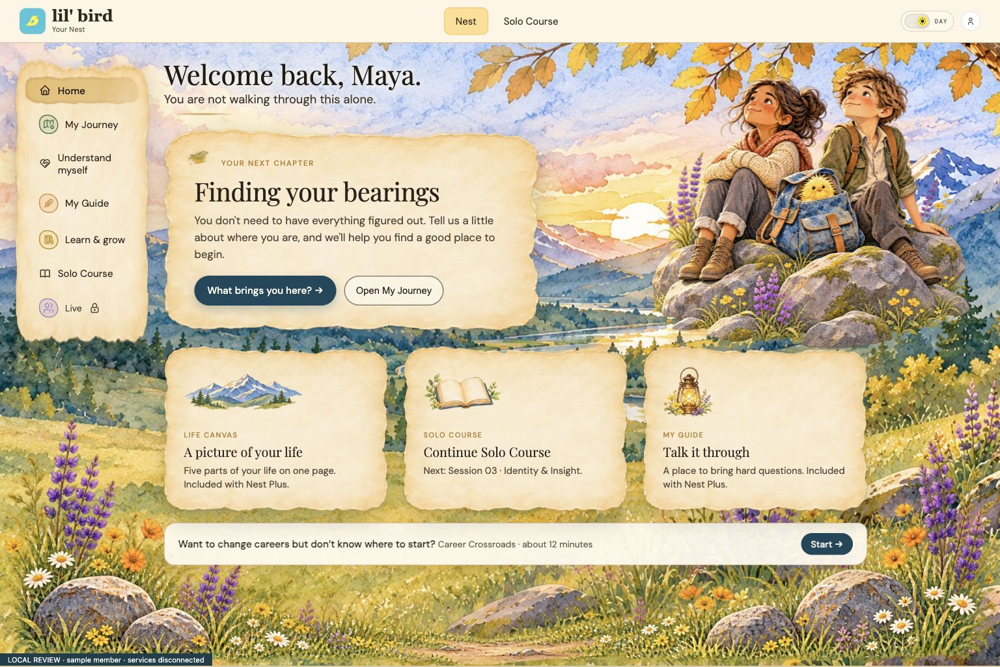
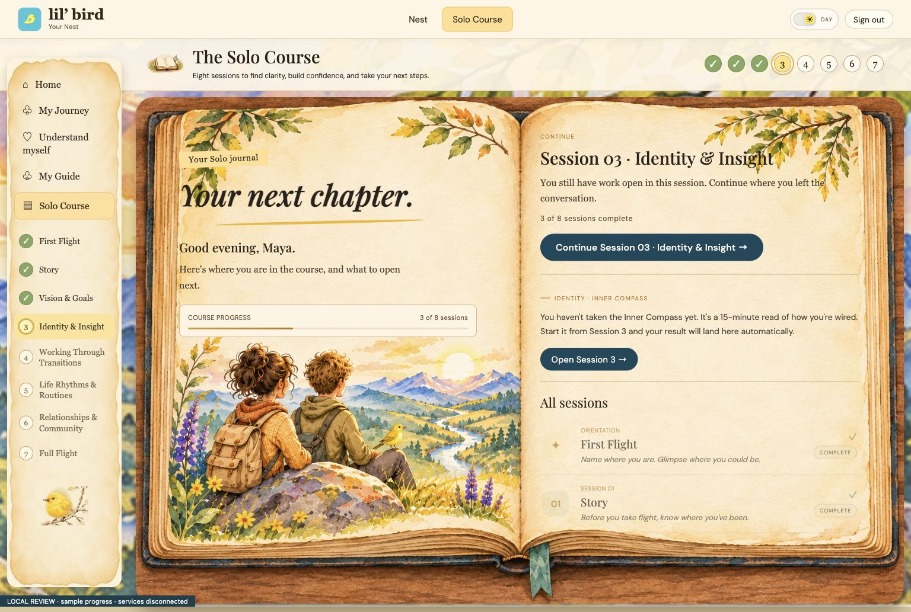
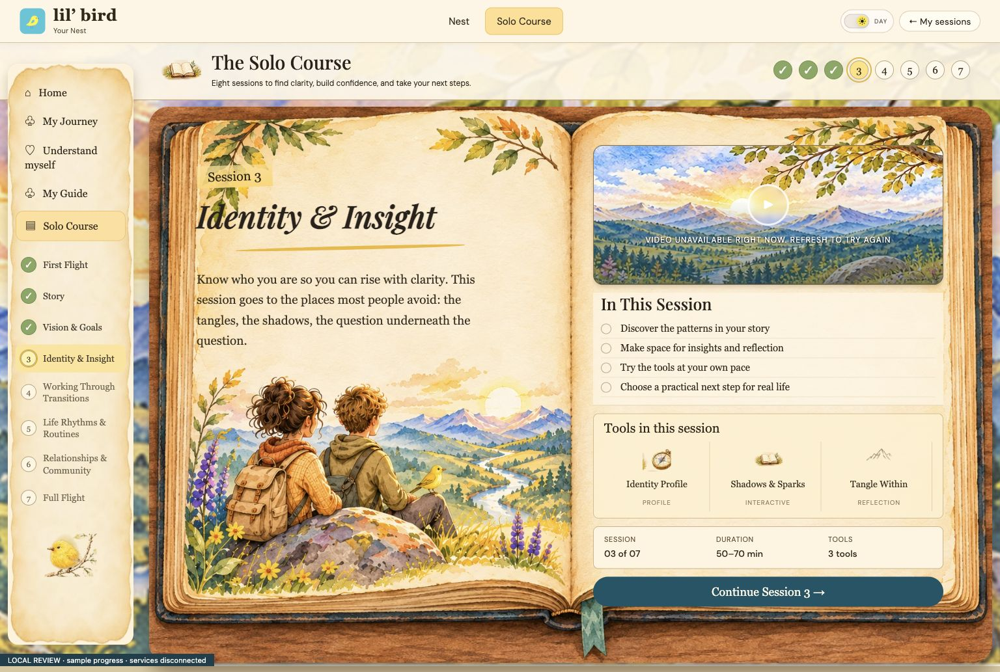
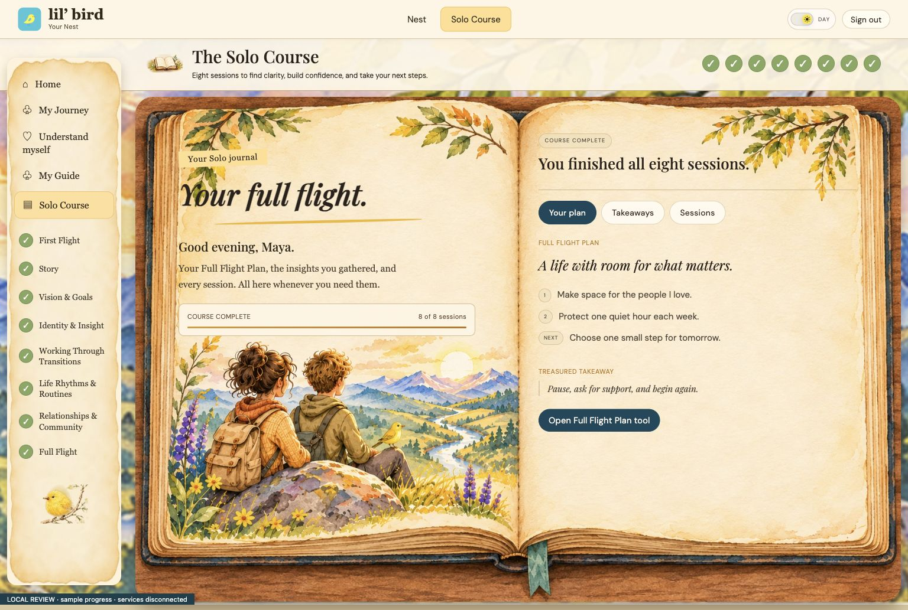
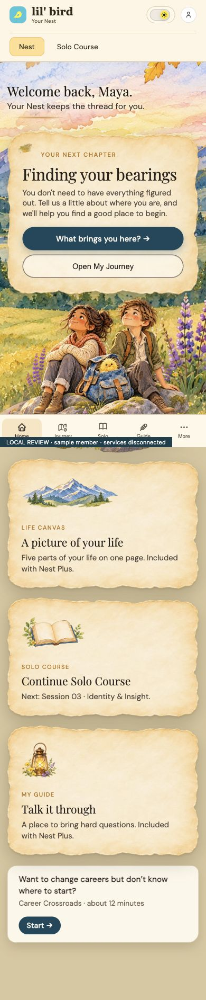
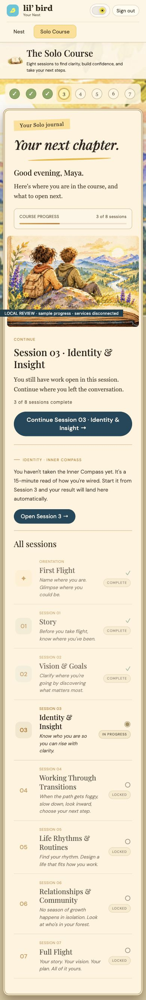
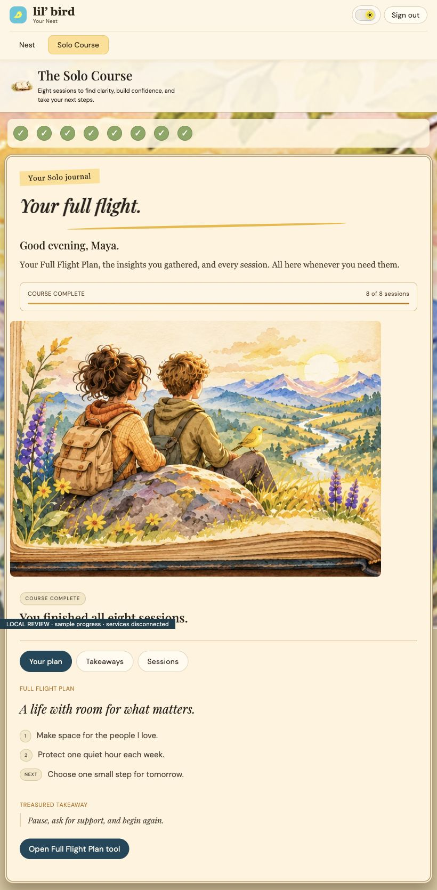

# Continuous Nest and Solo journal — review only

Solo home now opens inside the same illustrated book as the sessions. Nest, home and sessions share the cream header, product navigation, valley backgrounds, typography and paper palette. Desktop home and session book bounds match; mobile becomes a readable vertical journal.

Existing dashboard renderers, course access, chat, tools, saved progress, time-based unlocks and signed videos remain in use. Both book rails now use one navigation renderer with the existing access and unlock checks. Completed members retain Your plan, Takeaways and Sessions.

## Verification

- 28 JavaScript tests pass, including revoked-access navigation and matching home/session locks.
- 4 preview media-serving tests pass.
- Real local browser screenshots at 1536px desktop, 820px tablet, 390px mobile; 320px checked without horizontal overflow.
- New, returning, waiting, completed and no-access sample states checked. Completed tabs and session-to-home return preserve sample data.
- Day/night checked; paper text remains dark and readable.

## Limits and remaining differences

Screenshots use disconnected sample data, not member records. There is no staging/test account, so no new live account write, chat save or payment was performed. Original signed-video playback remains the production default; local narration recordings are not included or published. Nest retains its existing dashboard composition while sharing the course world and header. Mobile deliberately stacks the two book pages; desktop keeps the illustrated spread. The home right page scrolls for longer course lists and plans.

No merge or deployment is part of this change.

## Screenshots

### Continuous Nest Desktop

### Continuous Solo Desktop

### Continuous Session Desktop

### Solo Home Complete Desktop

### Continuous Nest Mobile

### Continuous Solo Mobile

### Continuous Solo Tablet

